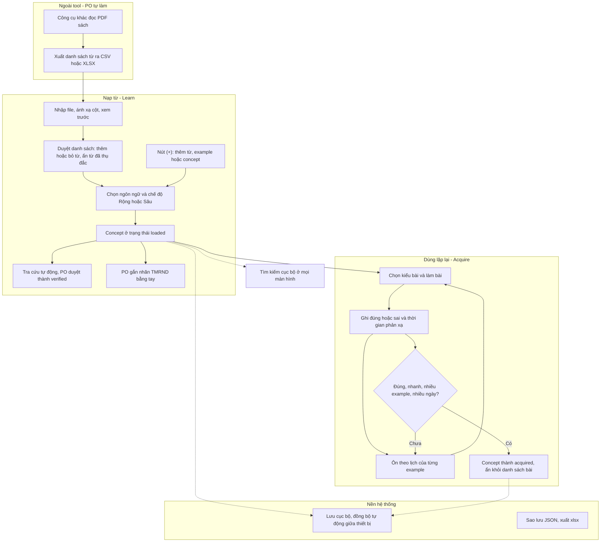
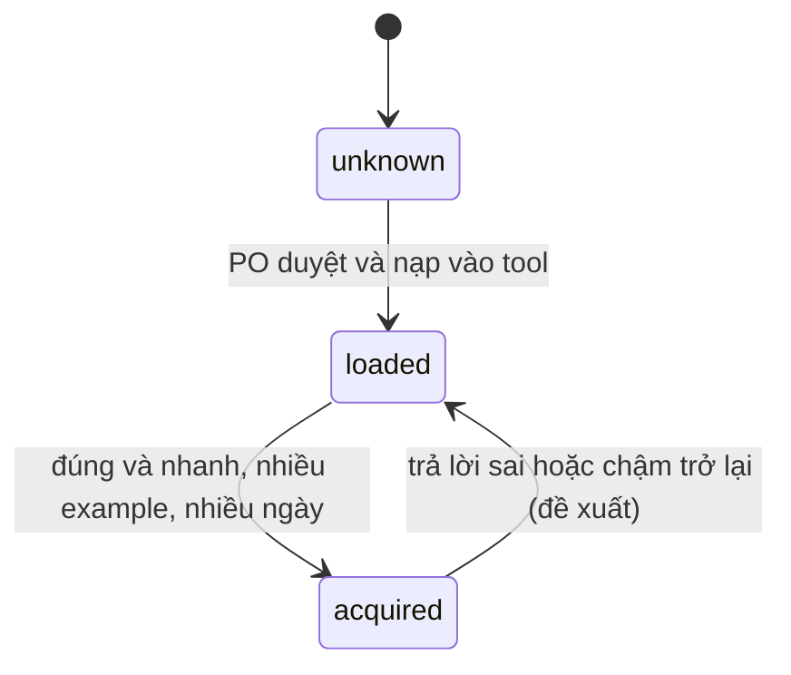
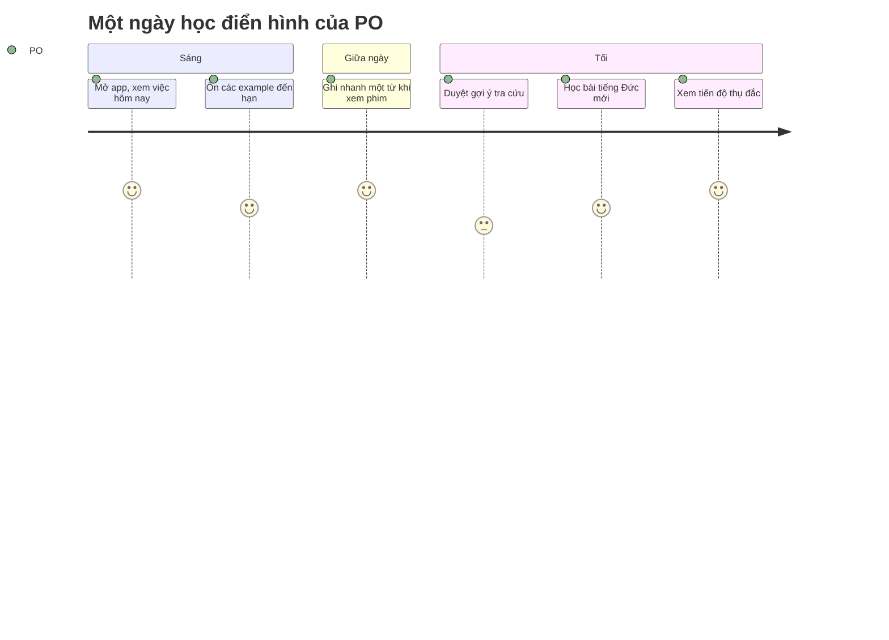
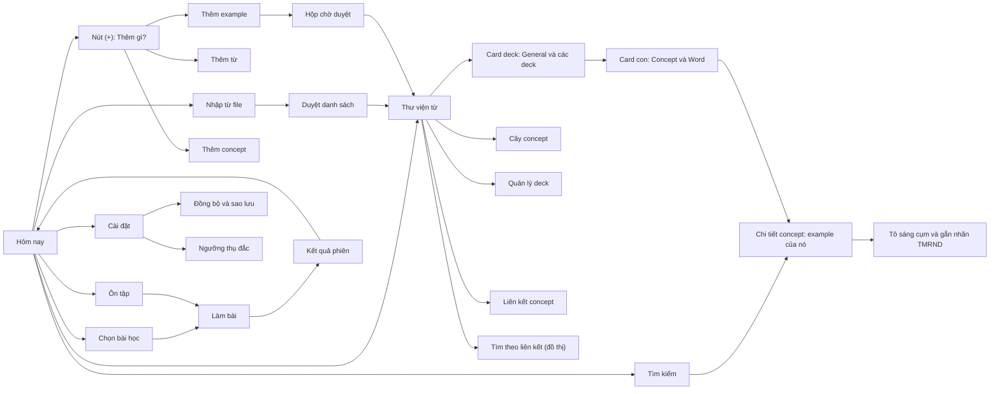
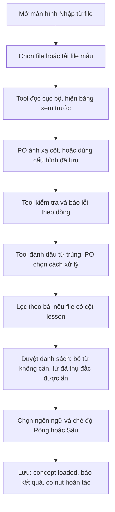
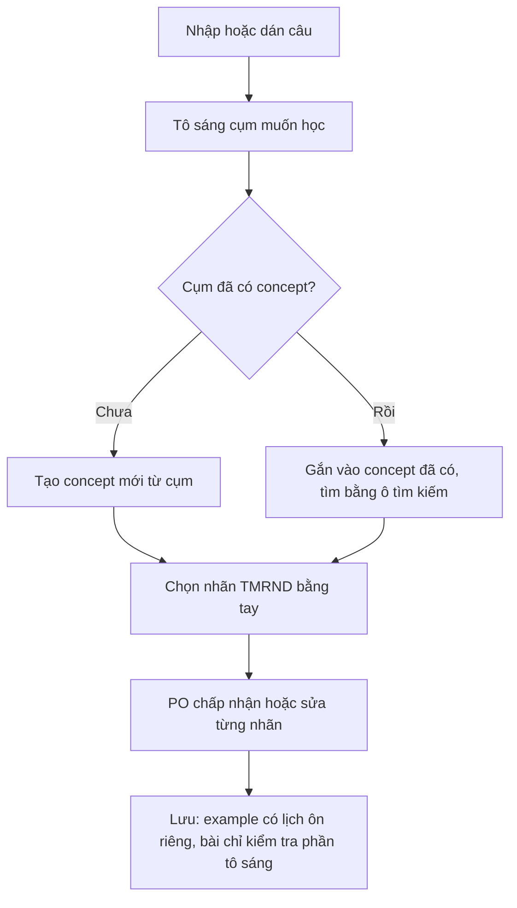

# USER JOURNEY: Công cụ học từ vựng Anh – Đức

> Đi kèm `vocab-tool-spec.md` (v11). Viết tắt **TMRND** = Tone, Mode, Register, Nuance, Dialect. Mục đích: để Product Owner (PO) và người xây dựng cùng hiểu **PO sẽ dùng tool như thế nào, từng bước**, trước khi viết code.
> Quy ước: **[ĐÃ CHỐT]** = lấy từ spec đã thống nhất. **[ĐỀ XUẤT UI]** = gợi ý giao diện/hành vi, spec chưa quy định. **[GIẢ ĐỊNH]** = hệ thống giả định, cần PO xác nhận (mục 7).
> Mọi sơ đồ dùng Mermaid; nếu trình xem không hiển thị sơ đồ, đọc phần bảng đi kèm.

---

## 1. Người dùng và bối cảnh

| Mục | Nội dung |
|---|---|
| Người dùng | PO, **một mình**, một tài khoản, nhiều thiết bị |
| Thiết bị | Điện thoại (chính, học mọi lúc) và máy tính (nhập file, quản lý) |
| Tiếng Anh | B2: thiếu **độ rộng** (từ đời thường ngoài sách giáo khoa) và **độ sâu** (tone, mode, register, nuance, dialect) |
| Tiếng Đức | A1–A2: học **chế độ Rộng** ngay từ đầu |
| Nguồn từ | Sách (PO dùng **công cụ ngoài** để chuyển thành file CSV/XLSX), cộng từ ghi nhanh khi xem phim/đọc sách |
| Tiêu chí thụ đắc | Trả lời **đúng và nhanh**, trong **nhiều example** khác nhau, qua **nhiều ngày** |
| Ràng buộc | Hoàn toàn miễn phí, dùng được khi không có mạng (local-first), tự đồng bộ giữa thiết bị |

**Việc nằm ngoài tool [ĐÃ CHỐT]:** đọc PDF, OCR, AI quét trang. Tool nhận file CSV/XLSX hoặc từ/câu gõ tay. **Tool không dùng AI (v7); nhãn TMRND do PO gắn tay.**

---

## 2. Bức tranh tổng thể

### 2.1 Vòng đời của một từ (concept) [ĐÃ CHỐT]

Song song với trạng thái học, mỗi từ/example mang **trạng thái kiểm chứng**: `unverified` (do tra cứu tự động hoặc ghi nhanh) → `verified` (PO đã duyệt). Nhãn TMRND của example có trạng thái riêng: `empty` → `verified` (PO tự gắn; trạng thái `suggested` là di sản của AI đã bỏ).

### 2.2 Một ngày học điển hình (minh họa)

Điểm số là mức trải nghiệm mà thiết kế hướng tới (5 là dễ chịu nhất), không phải số đo.

### 2.3 Bản đồ màn hình [ĐỀ XUẤT UI]

---

## 3. Các hành trình chi tiết

Mỗi hành trình gồm: mục tiêu, điểm bắt đầu, các bước (PO làm gì, hệ thống phản hồi gì), kết quả, ngoại lệ, và liên hệ với spec.

### J0. Lần đầu mở app

- **Mục tiêu:** có app trên cả điện thoại và máy tính, dữ liệu tự đồng bộ.
- **Bắt đầu:** PO mở đường link của app.

| # | PO làm | Hệ thống phản hồi |
|---|---|---|
| 1 | Mở link trên điện thoại | Hiện app; gợi ý **thêm vào màn hình chính** (PWA) |
| 2 | Đăng nhập bằng email hoặc Google | Tạo tài khoản; **tự tạo một bộ từ điển mặc định cho mỗi ngôn ngữ** (Anh, Đức) |
| 3 | Mở link trên máy tính, đăng nhập cùng tài khoản | Cùng dữ liệu xuất hiện (rỗng ở lần đầu) |

- **Kết quả:** app sẵn sàng; màn hình Hôm nay hiển thị trạng thái trống kèm gợi ý "Nhập từ file" hoặc "Ghi nhanh".
- **Ngoại lệ:** không có mạng lúc đăng nhập đầu tiên → báo cần mạng cho lần đăng nhập đầu; các lần sau dùng được offline.
- **Spec:** E1, E4, C6. **Mốc:** M0, M7b.

---

### J1. Nhập danh sách từ từ file (từ sách)

- **Mục tiêu:** đưa từ của một bài sách vào tool, chỉ giữ những từ cần học.
- **Bắt đầu:** PO đã có file CSV/XLSX từ công cụ ngoài.

| # | PO làm | Hệ thống phản hồi |
|---|---|---|
| 1 | (Ngoài tool) Dùng công cụ khác để tạo file từ sách | — |
| 2 | Mở **Nhập từ file**, chọn file (hoặc tải **file mẫu** để biết định dạng) | Đọc file ngay trên máy, nhận diện dấu phân cách và mã hóa, hiện **bảng xem trước** |
| 3 | Chỉ cột nào ứng với `text`, `meaning`, `pos`, `lesson`, `example`… | Lưu cấu hình ánh xạ; lần sau tự gợi ý lại |
| 4 | Xem báo lỗi | Liệt kê lỗi theo dòng: thiếu `text`, giá trị thuộc tính không thuộc bộ PVO, ký tự lỗi mã hóa |
| 5 | Chọn xử lý từ trùng | Với từ đã có: **bỏ qua**, **gộp thêm example**, hoặc **cập nhật** |
| 6 | Chọn bài cần nạp (nếu file có nhiều bài) | Chỉ hiện các dòng của bài đã chọn |
| 7 | Ở màn hình **Duyệt danh sách** (Bản 7: hiện đủ thông tin file sẽ nạp: loại từ, deck, giống, số nhiều, dạng động từ, câu ví dụ có tô sáng, nhãn, ghi chú), bỏ những từ không muốn học | Từ đã `acquired` **tự ẩn**; PO vẫn có thể bỏ thủ công từ mình đã biết mà tool chưa ghi nhận |
| 8 | Chọn **ngôn ngữ** (nếu file không có cột `lang`) và **chế độ** Rộng hoặc Sâu | Xác nhận đích đến |
| 9 | Bấm xác nhận | Lưu concept ở trạng thái `loaded`; concept nào chưa có câu ví dụ thì tự tạo **example tối thiểu**; với dòng có câu ví dụ, tool **tự tô sáng** chính cụm đó trong câu; báo "đã nạp N từ, bỏ M, trùng K"; có nút **Hoàn tác lần nhập này** |
| 10 | (Tùy chọn) Chấp nhận gợi ý "Tra cứu tự động cho các từ còn thiếu thông tin" | Chuyển sang J3 |

- **Kết quả:** danh sách concept của bài đã nằm trong tool, sẵn sàng học.
- **Ngoại lệ:**
  - Ký tự ä, ö, ü, ß bị lỗi → xem trước hiển thị sai, tool gợi ý đổi mã hóa.
  - File trống hoặc không có cột `text` → báo rõ và không ghi gì.
  - Nhập lại cùng file → không tạo bản sao (nhờ phát hiện trùng).
  - Câu ví dụ dùng dạng biến thể của từ (ví dụ *swallowed* so với *swallow*) → tool không tìm thấy `text` trong câu, đánh dấu để PO **tô sáng tay** ở bước duyệt.
  - Mất mạng → không ảnh hưởng (xử lý hoàn toàn cục bộ).
- **Spec:** A1–A1e, A3, A4, A6, A7, mục 6.4. **Mốc:** M3.

---

### J2. Thêm nhanh từ, example hoặc concept (nút +)

- **Mục tiêu:** lưu một từ, cụm hoặc câu mới gặp **mà không làm đứt mạch** tiếp nhận ngôn ngữ.
- **Bắt đầu:** PO đang xem phim/đọc sách, cầm điện thoại.

| # | PO làm | Hệ thống phản hồi |
|---|---|---|
| 1 | Bấm nút **(+)** (một chạm từ màn hình chính) | Màn **"Bạn muốn thêm gì?"** với ba thẻ lớn, mỗi thẻ có định nghĩa và ví dụ: **Thêm từ** (từ/cụm đứng riêng kèm nghĩa, hợp danh từ như "máy bay", "cửa sổ"), **Thêm example** (câu/cách diễn đạt, hợp động từ), **Thêm concept** (một ý, chưa có cách nói). Bấm một thẻ: ô nhập tự focus, ngôn ngữ và deck lấy theo lần dùng gần nhất |
| 2a | **Thêm từ:** chọn deck, gõ từ/cụm, nghĩa, chọn loại từ bằng hộp chọn (nghĩa và loại từ không bắt buộc). **Tiếng Đức (Bản 7):** chọn Noun thì có thêm giống và số nhiều; chọn Verb thì có thêm Infinitiv, Präsens er/sie/es, Präteritum, Partizip II; thêm khối thu gọn Câu ví dụ (tự tô sáng word) và Ghi chú. Có câu thì lưu example thật gắn vào word, không tạo example tối thiểu | Lưu concept `word` kèm example tối thiểu (chính nó); mặc định vào deck General; ô "Ở lại trang này" giữ form để nhập tiếp |
| 2b | **Thêm example:** gõ hoặc dán **cả câu**, **tô sáng đúng cụm muốn học**, chọn nhãn TMRND và **chọn concept** mà example thuộc về (tìm hoặc tạo mới tại chỗ). Có thể mở **Thêm concept** rồi nhập luôn nhiều example ngay dưới tên concept | Tạo concept từ cụm tô sáng (hoặc gợi ý concept đã có nếu cụm đã tồn tại); lưu câu làm example; **phần còn lại của câu chỉ là ngữ cảnh** |
| 2c | **Thêm example, chưa tô sáng:** lưu câu mà chưa tô sáng | Câu vào **Hộp chờ duyệt** ở dạng "câu chưa gắn concept", tô sáng sau (J10) |
| 3 | Quay lại xem phim | Mục vừa lưu nằm trong Hộp chờ duyệt với trạng thái `unverified` |

- **Sau đó (khi rảnh):** PO mở Hộp chờ duyệt; tool tra cứu tự động bổ sung nghĩa (J3); PO có thể gắn nhãn TMRND tay (J10); rồi duyệt.
- **Mục tiêu thao tác:** từ lúc mở app đến lúc lưu xong không quá khoảng 2 thao tác với Cách 1. **[ĐỀ XUẤT UI]**
- **Ngoại lệ:** gõ trùng từ đã có → báo "đã có", không tạo bản sao; PO có thể thêm example mới cho từ đó.
- **Spec:** A5, A8, C4, C7. **Mốc:** M2.

---

### J3. Tra cứu tự động và duyệt

- **Mục tiêu:** có nghĩa, giống/số nhiều, dạng chia động từ, ví dụ chính xác mà không phải tra tay từng từ.
- **Bắt đầu:** PO có từ chưa đủ thông tin (từ J1 hoặc J2).

| # | PO làm | Hệ thống phản hồi |
|---|---|---|
| 1 | Chọn các từ cần tra cứu (hoặc "tất cả từ còn thiếu") | Gửi **từng từ đơn lẻ** tới nguồn tra cứu, **giãn nhịp** và chạy nền; hiện tiến độ |
| 2 | Tiếp tục dùng app trong lúc chờ | Kết quả đổ dần vào từng từ, đánh dấu `unverified` |
| 3 | Mở một từ, xem gợi ý | Hiện nghĩa, loại từ, giống/số nhiều (Đức), dạng chia, ví dụ, thuộc tính đề xuất, **nguồn của từng thông tin** |
| 4 | Sửa nếu sai, rồi **duyệt** | Chuyển thành `verified` |

- **Kết quả:** từ có dữ liệu đầy đủ và đã được PO kiểm chứng.
- **Ngoại lệ:**
  - Nguồn không có từ này → báo "không tìm thấy", PO nhập tay.
  - Hết hạn mức hoặc mất mạng → báo, giữ nguyên trạng thái, có thể thử lại sau; app vẫn dùng bình thường.
  - Với tiếng Đức, mục từ nguồn ở dạng thô nên có thể thiếu giống/số nhiều → từ đó chưa dùng được cho bài giống/số nhiều cho đến khi PO bổ sung.
- **Spec:** A8, mục 6.5. **Mốc:** M3b.

---

### J4. Học tiếng Đức, chế độ Rộng (Bản 1)

- **Mục tiêu:** nạp từ A1–A2 và bắt đầu dùng lặp lại.
- **Bắt đầu:** PO có concept tiếng Đức ở trạng thái `loaded`.

| # | PO làm | Hệ thống phản hồi |
|---|---|---|
| 1 | Mở **Chọn bài học**, chọn **Tiếng Đức → Rộng** | Hiện các kiểu bài |
| 2 | Chọn **kiểu bài**: nghe chép chính tả · điền giống (der/die/das) và số nhiều · chia động từ · dạng động từ bất quy tắc | Chọn phạm vi (một bài, hoặc tất cả từ đã nạp) và số câu mỗi phiên |
| 3 | Bắt đầu làm bài | Hiện câu hỏi; với nghe chép thì **phát âm từ** bằng giọng đọc của máy; **bấm giờ từ lúc câu hỏi hiện đến lúc PO trả lời** |
| 4 | Trả lời | Chấm đúng/sai ngay; nếu sai, hiện đáp án đúng; ghi log (đúng/sai, thời gian, example đã dùng) |
| 5 | Làm hết phiên | **Kết quả phiên**: số câu đúng, thời gian phản xạ trung bình, từ yếu, số từ mới thụ đắc |

- **Danh từ tiếng Đức luôn học kèm giống và số nhiều.** [ĐÃ CHỐT]
- **Khi example có cụm tô sáng:** bài nghe chép mặc định chép **cụm tô sáng**, có tùy chọn chép cả câu. [GIẢ ĐỊNH G11]
- **Ngoại lệ:**
  - Máy không có giọng `de-DE` → báo, cho phép tắt kiểu bài nghe chép hoặc hướng dẫn cài giọng.
  - Từ thiếu thông tin cần cho kiểu bài (ví dụ chưa có số nhiều) → tự loại khỏi kiểu bài đó và gợi ý tra cứu (J3).
- **Spec:** B1–B3, mục 5.1, C5, D1, D2. **Mốc:** M4, M5.

---

### J5. Học tiếng Anh, chế độ Rộng (Bản 2)

- **Mục tiêu:** lấp lỗ hổng từ đời thường (như *chew, swallow, vomit, faint*).
- **Bắt đầu:** PO có concept tiếng Anh `loaded`.

| # | PO làm | Hệ thống phản hồi |
|---|---|---|
| 1 | Chọn **Tiếng Anh → Rộng** | Hiện kiểu bài của chế độ Rộng |
| 2 | Với **danh từ**: học từ đơn rồi làm bài đặt từ vào câu | Hiện từ, sau đó đưa vào câu/ngữ cảnh |
| 3 | Với **động từ**: học theo **cụm** rồi làm bài đặt vào ngữ cảnh | Hiện cụm (collocation/phrasal), sau đó đưa vào ngữ cảnh |
| 4 | Trả lời | Chấm, đo thời gian, ghi log như J4 |

- **Khi example có cụm tô sáng:** bài điền che đúng cụm đó; phần còn lại của câu là ngữ cảnh. [GIẢ ĐỊNH G10]
- **Kiểu bài** (spec 5.2): điền cụm tô sáng (`en.cloze`), cho nghĩa gõ từ (`en.meaning-to-word`), cho từ chọn nghĩa (`en.word-to-meaning`), nghe chép (tùy chọn). Đáp án không phân biệt hoa/thường. [ĐỀ XUẤT]
- **Ngoại lệ:** concept chưa `verified` (nghĩa còn là gợi ý tiếng Anh từ tra cứu) thì không vào bài nghĩa/từ → gợi ý duyệt ở J3; không đủ 4 nghĩa để làm lựa chọn nhiễu → bài chọn nghĩa tự bỏ qua.
- **Spec:** mục 5.2 (Rộng), C7, D1, D2. **Mốc:** M9a, M9b (Bản 2).

---

### J6. Học tiếng Anh, chế độ Sâu (Bản 3)

- **Mục tiêu:** dùng từ đúng tone, mode, register, nuance, dialect.
- **Bắt đầu:** PO muốn học các cách nói khác nhau cho cùng một ý (ví dụ chào hỏi).

**Phần A: xây dữ liệu (theo mô hình PVO)**

| # | PO làm | Hệ thống phản hồi |
|---|---|---|
| 1 | Tạo concept "chào hỏi" | Lưu concept |
| 2 | Thêm example *Hello*, *Hi*, *Greetings* | Mỗi example có 5 thuộc tính (mặc định Neutral) và ô Note |
| 3 | Đặt thuộc tính cho từng example (ví dụ *Hi* → Tone: Informal; *Greetings* → Tone: Formal) | Chỉ cho chọn giá trị trong **bộ mặc định PVO**; nhãn như "slang" ghi vào Note |
| 4 | Liên kết example với concept (loại liên kết: Idiom, Nominal, Agent, Patient, Action, Described by, Describing, Other phrase) | Lưu liên kết; mặc định là không liên kết |
| 5 | Liên kết concept với concept (Association, Type of) | **Chặn tạo vòng tròn**; xem được ở **cây/bảng concept** |
| 6 | ~~Bấm Gợi ý TMRND~~ (đã bỏ ở v7) | PO tự chọn 5 nhãn ở ô chọn; lưu tay thì thành `verified` |

**Phần B: làm bài**

| # | PO làm | Hệ thống phản hồi |
|---|---|---|
| 1 | Chọn **Tiếng Anh → Sâu** → kiểu bài | **Gắn nhãn (S1):** hiện một example, PO chọn thuộc tính. **Chọn từ hợp ngữ cảnh (S2):** hiện một tình huống có tone/mode xác định, PO chọn example/concept phù hợp nhất trong nhóm liên kết |
| 2 | Trả lời | Chấm theo nhãn đã `verified`; ghi log theo example |

- **Collocation và idiom** được biểu diễn bằng loại liên kết example – concept (*Idiom*, *Other phrase*). [ĐÃ CHỐT]
- **Ngoại lệ:** nhóm có ít hơn hai lựa chọn thì không tạo được bài S2 → tool nhắc PO thêm example/concept liên kết.
- **Ghi chú:** nhãn không có trong bộ PVO (như slang) thì ghi vào Note.
- **Cách thao tác nối liên kết (v9, M12b–M12d):** (a) concept–concept: ở màn Concept chọn con, chọn cha, chọn Relation rồi Save, câu `con → cha` luôn hiện rõ; chọn "No link" để xóa; nối ngược cặp đã có thì app hỏi đổi chiều; vòng tròn bị chặn. (b) example–concept: ngay trong màn example, một danh sách "Liên kết" (chọn concept bằng ô tìm kiếm, chọn loại, bấm Link). (c) Xem: màn Tree với cha ở trên, concept ở giữa, con ở dưới và hàng đếm theo 8 loại liên kết, bấm loại để xem ví dụ.
- **Spec:** mục 1.3, mục 5.2 (Sâu), mục 8, E5, Bản 3b. **Mốc:** Bản 3, M12.

---

### J7. Ôn tập hằng ngày

- **Mục tiêu:** dùng lại từ cũ đúng lúc, đa dạng để không nhàm.
- **Bắt đầu:** PO mở app.

| # | PO làm | Hệ thống phản hồi |
|---|---|---|
| 1 | Mở màn hình **Hôm nay** | Hiện số **example đến hạn ôn** hôm nay (lịch tính theo từng example) |
| 2 | Bấm **Ôn tập** | Tạo phiên gồm các example đến hạn, **xáo kiểu bài**, mỗi lần dùng **example khác** của cùng concept |
| 3 | Làm bài | Chấm, đo thời gian, ghi log; lịch ôn của example được cập nhật |
| 4 | (Tùy chọn) Bấm **Phản xạ chớp nhoáng** | Vòng bấm giờ ngắn rèn thụ đắc |
| 5 | Kết thúc phiên | Kết quả phiên; nếu có từ vừa đạt tiêu chí thì báo "N từ mới thụ đắc" |

- **Ngoại lệ:** không có example nào đến hạn → báo "Hôm nay không có gì cần ôn", gợi ý học bài mới hoặc phản xạ chớp nhoáng.
- **Spec:** D3, D4. **Mốc:** M6.

---

### J8. Xem tiến độ thụ đắc

- **Mục tiêu:** biết từ nào đang ở đâu trên đường từ *learn* đến *acquire*.
- **Bắt đầu:** PO mở **Thư viện từ**.

| # | PO làm | Hệ thống phản hồi |
|---|---|---|
| 1 | Mở Thư viện, lọc theo ngôn ngữ, trạng thái (`loaded`/`acquired`), bài, độ kiểm chứng, nhãn TMRND, hoặc dùng ô tìm kiếm (J11) | Danh sách concept |
| 2 | Mở **Chi tiết từ** | Hiện example, thuộc tính, lịch sử trả lời, và **tiến độ so với tiêu chí thụ đắc** (ví dụ: đúng 3/5 lần, 2/3 example, 2/3 ngày, thời gian phản xạ so với ngưỡng) |
| 3 | (Chế độ Sâu) Mở **Cây hoặc bảng concept** | Xem cấu trúc cha–con và các example gắn với concept |

- **Spec:** E5, mục 2, D2. **Mốc:** M5, Bản 3.

---

### J9. Đổi thiết bị, đồng bộ, sao lưu và cài đặt

- **Mục tiêu:** dữ liệu luôn đồng nhất, không bao giờ mất, ngưỡng thụ đắc chỉnh được.

| # | PO làm | Hệ thống phản hồi |
|---|---|---|
| 1 | Học trên điện thoại | Lưu cục bộ trước, **tự đồng bộ nền** khi có mạng |
| 2 | Mở máy tính | Thấy dữ liệu mới nhất, không cần thao tác |
| 3 | Học khi mất mạng | Vẫn học bình thường; khi có mạng lại thì tự đồng bộ; nếu hai thiết bị cùng sửa một bản ghi thì **bản mới hơn thắng** |
| 4 | Vào **Cài đặt → Sao lưu** | **Xuất JSON** (đầy đủ), **xuất xlsx** (cùng bộ cột với file mẫu nhập) |
| 5 | Vào **Cài đặt → Ngưỡng thụ đắc** | Chỉnh số lần đúng, số example, số ngày, thời gian phản xạ tối đa |

- **Ngoại lệ:** dịch vụ đồng bộ hết hạn mức → dừng đồng bộ, báo rõ, app vẫn dùng đầy đủ trên từng thiết bị; PO dùng sao lưu JSON làm phương án thay thế.
- **Spec:** E2–E4, mục 6.3, mục 2. **Mốc:** M7, M7b.

### J10. Thêm câu ví dụ, tô sáng cụm cần học và gắn nhãn TMRND

- **Mục tiêu:** có một câu nhưng **chỉ muốn học cụm trong câu đó**; gắn đúng nhãn TMRND cho cách dùng.
- **Bắt đầu:** PO ở **Chi tiết từ → Thêm example**, hoặc mở một "câu chưa gắn concept" trong Hộp chờ duyệt.

| # | PO làm | Hệ thống phản hồi |
|---|---|---|
| 1 | Nhập hoặc dán câu | Hiện câu, sẵn sàng tô sáng |
| 2 | **Kéo chọn (tô sáng)** cụm muốn học | Cụm hiện nổi bật; phần còn lại hiện nhạt hơn như **ngữ cảnh** |
| 3 | Chọn tạo concept mới từ cụm, hoặc gắn vào concept đã có | Ô tìm kiếm tự gợi ý nếu cụm đã tồn tại, để tránh tạo trùng |
| 4 | Chọn nhãn TMRND bằng tay | PO tự chọn 5 nhãn; ghi "slang" vào Note nếu cần; lưu tay = `verified` |
| 5 | (Tùy chọn) Liên kết example với concept bằng loại liên kết (Idiom, Other phrase...) | Lưu liên kết |
| 6 | Lưu | Example có **lịch ôn riêng**; các bài tập chỉ kiểm tra phần tô sáng |
| 7 | (Tùy chọn) Bấm **Học thêm cụm khác trong câu này** | Tạo một example mới với cùng câu, tô sáng cụm khác |

- **Ngoại lệ:**
  - Không tô sáng gì → lưu thành "câu chưa gắn concept", chưa có lịch ôn cho đến khi tô sáng.
  - Tô sáng **cả câu** → cho phép; concept là cả câu (dùng cho câu cố định hoặc idiom).
  - Không có AI: mọi nhãn do PO gắn tay.
- **Spec:** C7, F3. **Mốc:** M2 (tô sáng), M10a (gắn nhãn tay).

---

### J11. Tìm kiếm

- **Mục tiêu:** tìm nhanh một từ, câu hoặc nhóm từ trong kho ngày càng lớn.
- **Bắt đầu:** PO ở màn hình Hôm nay hoặc Thư viện.

| # | PO làm | Hệ thống phản hồi |
|---|---|---|
| 1 | Gõ từ khóa vào ô tìm kiếm rồi bấm **Enter** (hoặc nút "Tìm") | Kết quả hiện nhanh, kể cả khi mất mạng; không tìm theo từng ký tự gõ (v11); phần khớp được đánh dấu; tìm trong từ, nghĩa, câu ví dụ, ghi chú |
| 2 | Thu hẹp bằng bộ lọc | Lọc theo ngôn ngữ, trạng thái, độ kiểm chứng, từng thuộc tính TMRND, bài, nguồn, "câu chưa gắn concept"; có sắp xếp |
| 3 | Mở một kết quả | Sang **Chi tiết từ** |
| 4 | (Trong lúc tô sáng, tạo liên kết, hoặc xử lý trùng khi nhập file) dùng chính ô tìm | Gợi ý concept đã có; nếu không có kết quả thì có nút **Thêm nhanh từ này** |

- **Tìm không phân biệt hoa/thường; bỏ dấu khi tìm nghĩa tiếng Việt; tiếng Đức coi ä/ae, ö/oe, ü/ue, ß/ss là tương đương.** [GIẢ ĐỊNH G12]
- **Ngoại lệ:** thiết bị mới hoặc sau khi nhập file lớn, chỉ mục tìm kiếm cần dựng lại → hiện "đang cập nhật", kết quả đầy đủ sau vài giây.
- **Làm sau:** tìm khoan dung lỗi gõ và tìm theo cách phát âm (F5).
- **Spec:** F1–F5, mục 6.7. **Mốc:** M2b.

---

### J12. Gom từ theo deck (IT, từ phim…)

- **Mục tiêu:** chọn ra đúng nhóm từ cần học hoặc ôn khi kho đã lớn.
- **Bắt đầu:** PO ở Thư viện, Ghi nhanh hoặc Nhập từ file.

| # | PO làm | Hệ thống phản hồi |
|---|---|---|
| 1 | Tạo deck ở **Quản lý deck** (hoặc ngay ở màn concept) | Tên deck không trùng trong một ngôn ngữ (không phân biệt hoa/thường) |
| 2 | Thêm từ (hoặc concept), chọn deck ở ô "Deck của concept" (mặc định General) | Từ vào deck; ô nhớ lựa chọn lần trước. Nếu từ đã có thì **chỉ thêm vào deck**, không tạo bản sao |
| 3 | Nhập file: chọn deck đích **từ danh sách deck có sẵn** (hoặc tạo mới); file có thể có cột `deck` | Từ mới và từ đã có đều vào deck; báo "N từ đã có được thêm vào deck"; hoàn tác khôi phục deck cũ |
| 4 | Ở Thư viện bấm một **card deck** (General hoặc deck của bạn) | Hiện hai **card con**: **Concept <deck>** và **Word <deck>**, kèm số mục (chỉ đếm). Bấm một card con mới tải danh sách; bấm một concept để xem example của nó |
| 5 | Ở Học hoặc Hôm nay chọn một hay nhiều deck | Số từ dùng được, số từ đến hạn và phiên ôn chỉ tính từ trong các deck đã chọn |
| 6 | Xóa deck | Ô xác nhận nêu số concept và example sẽ bị **xóa cùng deck** (v11, PO yêu cầu); concept còn nằm ở deck khác thì được giữ, chỉ bỏ khỏi deck này; có badge **Hoàn tác** khôi phục cả deck và nội dung |

- **Ngoại lệ:** deck có sẵn chỉ nhận từ cùng ngôn ngữ; cột `deck` trong file khớp deck theo tên (không phân biệt hoa/thường), tên mới thì tạo deck mới.
- **Spec:** C6, mục 10 Bản 4. **Mốc:** M13a, M13b.

---

### J13. Liên kết concept và tìm lại từ qua mạng liên kết

- **Mục tiêu:** nối các ý với nhau (cha/con) rồi nhớ lại từ qua mạng liên kết.
- **Bắt đầu:** PO ở Thư viện hoặc màn concept.

| # | PO làm | Hệ thống phản hồi |
|---|---|---|
| 1 | Mở **Liên kết concept**: chọn concept con, concept cha, quan hệ (No link / Association / Type of), Lưu | Dòng `con → cha` luôn hiện cả hai đầu; tìm theo từ hoặc mô tả; gõ từ chưa có thì **Thêm?** tạo ngay; No link = xóa liên kết |
| 2 | Nối ngược một cặp đã có | Hỏi đổi chiều; nếu tạo vòng dài hơn thì báo "Vòng tròn" và giữ liên kết cũ |
| 3 | Mở **Cây** của một concept | Cha ở trên, concept ở giữa, con ở dưới; hàng đếm ví dụ theo 8 loại liên kết, bấm một loại xem ví dụ (cụm tô vàng, nút sửa) |
| 4 | Ở màn ví dụ, quản lý danh sách **Liên kết** (concept chính + các liên kết kèm loại) | Một danh sách duy nhất; "Đặt làm chính" đổi concept chính; ví dụ ở Hộp chờ gắn concept đầu tiên thì rời Hộp chờ |
| 5 | Mở **Tìm theo liên kết**, chọn tối đa 10 concept | Đồ thị (đỏ = đã chọn, xám = liên quan, mũi tên con → cha) và danh sách concept nối một bước; chạm nút xám để thêm vào lựa chọn |

- **Spec:** mục 1.4, R1–R7 (Bản 3b). **Mốc:** M11c, M12a–d, Tìm theo liên kết.

---

### J14. Học theo đoạn văn (đục lỗ)

- **Mục tiêu:** học word trong ngữ cảnh cả một đoạn văn (ví dụ các hoạt động hằng ngày), không chỉ một câu.
- **Bắt đầu:** PO có một đoạn văn tiếng Anh hoặc tiếng Đức.

| # | PO làm | Hệ thống phản hồi |
|---|---|---|
| 1 | Bấm **(+) → Thêm đoạn văn**, dán đoạn văn (tiêu đề không bắt buộc) | Hiện ô đoạn văn |
| 2 | Chuyển sang chế độ **Đục lỗ**: chạm một word để đục lỗ (chạm lại để bỏ); muốn đục cả cụm thì bôi đen rồi bấm **Đục lỗ cụm đã chọn** | Lỗ hiện nền màu kèm số (1), (2)… ngay trên đoạn văn; chuyển **Sửa chữ** khi cần gõ, lỗ đi theo chữ |
| 3 | Chọn deck cho các word mới (mặc định General), bấm **Lưu đoạn văn** | Mỗi lỗ tự tạo word (hoặc gắn word đã có); chuyển sang màn **Đoạn văn** |
| 4 | Vào **Học → Điền vào đoạn văn** | Cả đoạn hiện ra và **các ô nhập nằm ngay trong đoạn văn**, đúng chỗ trống (đánh số nhỏ), không gợi ý |
| 5 | Điền các chỗ trống, bấm Kiểm tra | Chấm từng lỗ (không phân biệt hoa/thường), hiện đáp án lỗ sai; ghi log và lịch ôn cho từng lỗ |

- **Sửa đoạn đã lưu:** ở màn Đoạn văn bấm **Sửa**, sửa chữ hoặc tiêu đề; các lỗ đi theo chữ (không phải đục lại), có thể đục thêm hoặc bỏ lỗ; lỗ giữ lại vẫn giữ lịch ôn.
- **Ngoại lệ:** word đã thụ đắc hiện sẵn trong đoạn, không hỏi lại; nếu chỗ sửa cắt qua mép một lỗ thì lỗ đó bị bỏ (có báo) và bạn đục lại.
- **Spec:** Bản 6. **Mốc:** Bản 6.

---

### J15. Học và ôn theo bài (Bản 8)

- **Mục tiêu:** ôn đúng các từ của một hay vài bài trong giáo trình (ví dụ deck A1: Family, Daily activities), thay vì cả deck.
- **Bắt đầu:** PO đã nhập file có cột `lesson`, hoặc tự tạo bài.

| # | PO làm | Hệ thống phản hồi |
|---|---|---|
| 1 | Nhập file có cột `lesson` vào deck A1 | Bài được tạo trong deck theo thứ tự xuất hiện trong file; bước duyệt hiện bài của từng từ; nhập lại không tạo bài trùng |
| 2 | Mở **Thư viện → deck A1 → Bài** | Danh sách bài kèm số từ; bấm một bài thì ra ngay các từ của bài (~20 từ) |
| 3 | Mở **Quản lý bài** của deck | Đổi tên, đổi thứ tự, xóa bài (có ô xác nhận và Hoàn tác); xóa bài chỉ gỡ nhãn bài khỏi các từ |
| 4 | Thêm tay một word hoặc mở chi tiết concept, chọn bài ở hộp chọn "Bài" | Hộp chọn chỉ liệt kê bài của deck đã chọn; có "+ Tạo bài mới…"; không gõ tay nên không có bài trùng do gõ sai |
| 5 | Ở **Ôn tập** (hoặc Học, Phản xạ chớp nhoáng, Hôm nay) chọn deck A1 rồi tick một hoặc nhiều bài | Số từ đến hạn và phiên ôn chỉ tính từ trong các bài đã tick (không tick = cả deck) |

- **Ngoại lệ:** từ thuộc một bài; từ cần ở hai chủ đề thì thêm vào deck khác. Gỡ từ khỏi deck của bài thì từ rời bài đó. Từ không thuộc deck nào nằm trong deck General, và General cũng có bài.
- **Spec:** C6, Bản 8. **Mốc:** M15a–M15f.

---

## 4. Ma trận: hành trình ↔ chức năng ↔ cột mốc

| Hành trình | Chức năng spec | Cột mốc | Bản |
|---|---|---|---|
| J0 Lần đầu mở app | E1, E4, C6 | M0, M7b | 1 |
| J1 Nhập từ file | A1–A1e, A3, A4, A6, A7 | M3 | 1 |
| J2 Thêm từ / example / concept (nút +) | A5, C4, C7 | M2, Bản 5 | 1 và 5 |
| J3 Tra cứu tự động | A8 | M3b | 1 |
| J4 Tiếng Đức Rộng | B, 5.1, C5, D1, D2 | M4, M5 | 1 |
| J5 Tiếng Anh Rộng | 5.2 (Rộng) | M9a, M9b | 2 |
| J6 Tiếng Anh Sâu | 1.3, 5.2 (Sâu), 8, E5 | Bản 3 | 3 |
| J7 Ôn tập hằng ngày | D3, D4 | M6 | 1 |
| J8 Xem tiến độ | E5, mục 2 | M5, Bản 3 | 1 và 3 |
| J9 Đồng bộ và sao lưu | E2–E4 | M7, M7b | 1 |
| J10 Tô sáng cụm và gắn TMRND | C7, F3 | M2, M10a | 1 và 2 |
| J11 Tìm kiếm | F1–F5, 6.7 | M2b | 1 |
| J12 Gom từ theo deck | C6, Bản 4, Bản 5 | M13a, M13b, Bản 5 | 4 và 5 |
| J13 Liên kết concept và tìm qua mạng liên kết | 1.4, R1–R7 | M11c, M12a–d | 3 và 3b |
| J14 Học theo đoạn văn (đục lỗ) | Bản 6 | Bản 6 | 6 |
| J15 Học và ôn theo bài | C6, Bản 8 | M15a–M15f | 8 |

---

## 5. Những điều tool KHÔNG làm

- Không đọc PDF, không OCR, không dùng AI (kể cả gợi ý nhãn TMRND, đã bỏ ở v7). [ĐÃ CHỐT]
- Không gửi dữ liệu nào ra ngoài tài khoản của PO, ngoài **từ đơn lẻ** gửi đi tra cứu. [ĐỀ XUẤT]
- Không hiển thị đồ thị liên kết trực quan ở các bản đầu (chỉ cây/bảng thụt lề). [ĐÃ CHỐT] **Cập nhật 2026-11-05:** PO yêu cầu làm đồ thị cho màn Tìm theo liên kết (`/association`, spec R7); màn Tree vẫn là cây/bảng.
- Không có chế độ Sâu tiếng Đức ở các bản đầu. [ĐÃ CHỐT]
- Không nhập liên kết concept/example từ file ở bản đầu (PO tạo liên kết trong tool). [ĐỀ XUẤT]

---

## 6. Cảm xúc và rủi ro cần thiết kế cho

| Thời điểm | Rủi ro | Thiết kế đối phó |
|---|---|---|
| Nhập file | Sợ nhập sai làm bẩn dữ liệu | Xem trước, báo lỗi theo dòng, phát hiện trùng, nút hoàn tác |
| Ghi nhanh | Bị đứt mạch xem phim | Tối thiểu thao tác, ô nhập sẵn sàng, duyệt sau |
| Ôn tập | Nhàm vì lặp lại một kiểu | Xáo kiểu bài, đổi example, phản xạ chớp nhoáng |
| Duyệt tra cứu | Tin nhầm dữ liệu tự động | Luôn `unverified` đến khi PO duyệt, hiện nguồn |
| Gắn nhãn TMRND | Nhãn sai làm sai bài S1 | PO tự gắn; bài chỉ chấm theo nhãn đã `verified` |
| Tô sáng | Học nhầm cả câu thay vì cụm | Chỉ cụm tô sáng được kiểm tra, phần còn lại là ngữ cảnh |
| Tìm kiếm | Không tìm ra vì khác dấu (ä/a, ß/ss) | Chuẩn hóa khi tìm |
| Học khi mất mạng | Sợ mất dữ liệu | Local-first, đồng bộ nền, sao lưu JSON |

---

## 7. Giả định cần PO xác nhận lần cuối

Các điểm dưới đây là chỗ hành trình dựa vào **giả định của hệ thống**, spec chưa chốt. PO xác nhận "đúng" hoặc sửa:

| # | Giả định | Nằm ở |
|---|---|---|
| G1 | Từ **trả lời sai** thì hiện đáp án đúng ngay, ghi log, và **lịch ôn của example đó được kéo gần lại** | J4, J7 |
| G2 | Mỗi **phiên học** có số câu mặc định (ví dụ 10–20) và PO đổi được; có thể dừng giữa chừng mà không mất kết quả đã làm | J4 |
| G3 | **Thời gian phản xạ** tính từ lúc câu hỏi hiện đến lúc PO bắt đầu trả lời xong (với bài gõ thì đến lúc gửi); PO **thấy** thời gian trung bình ở cuối phiên | J4, J7 |
| G4 | Màn hình **Hôm nay** là màn hình mặc định, hiện số example đến hạn và lối tắt tới Nhập file, Ghi nhanh | J7 |
| G5 | Khi concept chuyển `acquired`, tool **chỉ thông báo cuối phiên**, không ngắt giữa lúc làm bài | J7 |
| G6 | Khi concept `acquired` trả lời sai/chậm trở lại thì tự hạ về `loaded` | 2.1 |
| G7 | PO có thể **thêm, sửa, xóa** concept và example thủ công trong tool (không chỉ nhập file) | J6, J8 |
| G8 | Mỗi concept thuộc một từ điển (mỗi ngôn ngữ một bộ tự tạo) và có thể nằm trong **nhiều deck** để gom theo mục đích | J0, J12 |
| G9 | Một example có **một** cụm tô sáng; muốn học thêm cụm thứ hai trong cùng câu thì tạo example mới (cùng câu, tô sáng khác) | J10 |
| G10 | Bài che cụm (điền): chỉ cụm tô sáng bị che và kiểm tra; phần còn lại của câu luôn hiện làm ngữ cảnh | J5, J10 |
| G11 | Nghe chép tiếng Đức khi có tô sáng: mặc định chép cụm tô sáng, có tùy chọn chép cả câu | J4 |
| G12 | Tìm kiếm không phân biệt hoa/thường, bỏ dấu tiếng Việt khi tìm nghĩa, ä=ae, ö=oe, ü=ue, ß=ss; chạy offline | J11 |
| G13 | ~~AI chỉ chạy khi PO bấm yêu cầu~~ **Không còn áp dụng (v7: đã bỏ AI)** | J6, J10 |
| G14 | Câu chưa tô sáng vẫn lưu được vào Hộp chờ duyệt và chưa có lịch ôn cho đến khi tô sáng | J2, J10 |
| G15 | **Deck** là nhãn gắn vào concept: một từ nằm được trong nhiều deck mà không nhập lại; xóa deck xóa luôn các concept (và example) chỉ nằm trong deck đó, concept còn ở deck khác được giữ, có Hoàn tác. Học/Ôn, Tìm kiếm, Thư viện, Nhập và Xuất file đều theo được deck | J12 |
| G16 | Xóa luôn có **ô xác nhận tại chỗ** nêu hậu quả, và sau đó có badge **Hoàn tác** (xóa mềm); không dùng hộp xác nhận của trình duyệt | J6, J8, J12 |
| G19 | Nút (+) có **ba lựa chọn tách hẳn**: Thêm từ, Thêm example, Thêm concept. Từ và concept cùng là một dòng `concepts`, chỉ khác `kind`; Thêm concept không tạo example tối thiểu | J2 |
| G20 | Từ không thuộc deck nào tự nằm trong deck **General** (mặc định ở Thư viện và các ô chọn deck); Thư viện đi **card deck → card con Concept/Word → danh sách**, chỉ tải khi bấm | J12 |
| G22 | **Bài (lesson)** là chủ đề có tên nằm trong một deck (khoảng 20 word), chọn bằng hộp chọn, đổi tên một chỗ thì cả bài đổi; một từ thuộc một bài; Học, Ôn và Thư viện theo được bài | J15 |
| G21 | Bài nhập chính tả **không phân biệt hoa/thường** (Anh và Đức), vẫn phân biệt `ä ö ü ß`; tìm kiếm chỉ chạy khi bấm Enter/"Tìm" | J4, J11 |
| G17 | Lưu xong thì **báo bằng badge và chuyển trang** (concept → Thư viện, ví dụ → concept hoặc Hộp chờ, Ghi nhanh → Thư viện); Ghi nhanh có ô "Ở lại trang này để ghi tiếp" cho nhập hàng loạt | J2, J10 |
| G18 | Liên kết concept luôn đọc theo chiều **con → cha**; nối ngược một cặp đã có thì hỏi đổi chiều; vòng tròn bị chặn | J13 |

### Còn mở từ spec (không cần quyết trong buổi này)
1. **Định dạng file nhập:** cần vài dòng đầu của file thật từ công cụ ngoài để chốt bộ cột (spec mục 9.2, câu 1).
2. **Thuật toán spaced repetition** (đơn vị là example): kiểu SM-2 đơn giản hay mới hơn.
3. **Chi tiết kỹ thuật** (CORS, hạn mức, parse Wiktionary tiếng Đức): kiểm khi triển khai.
